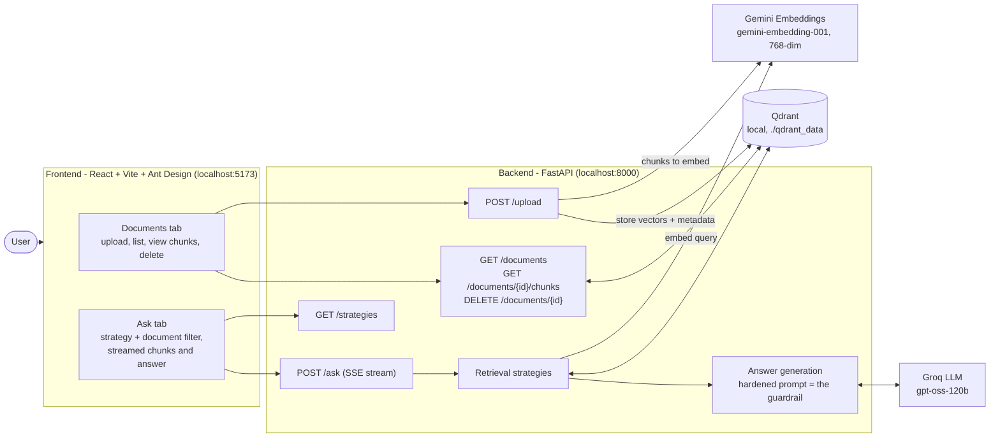
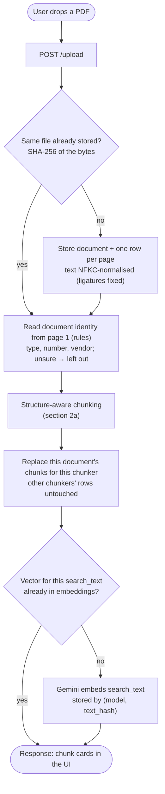
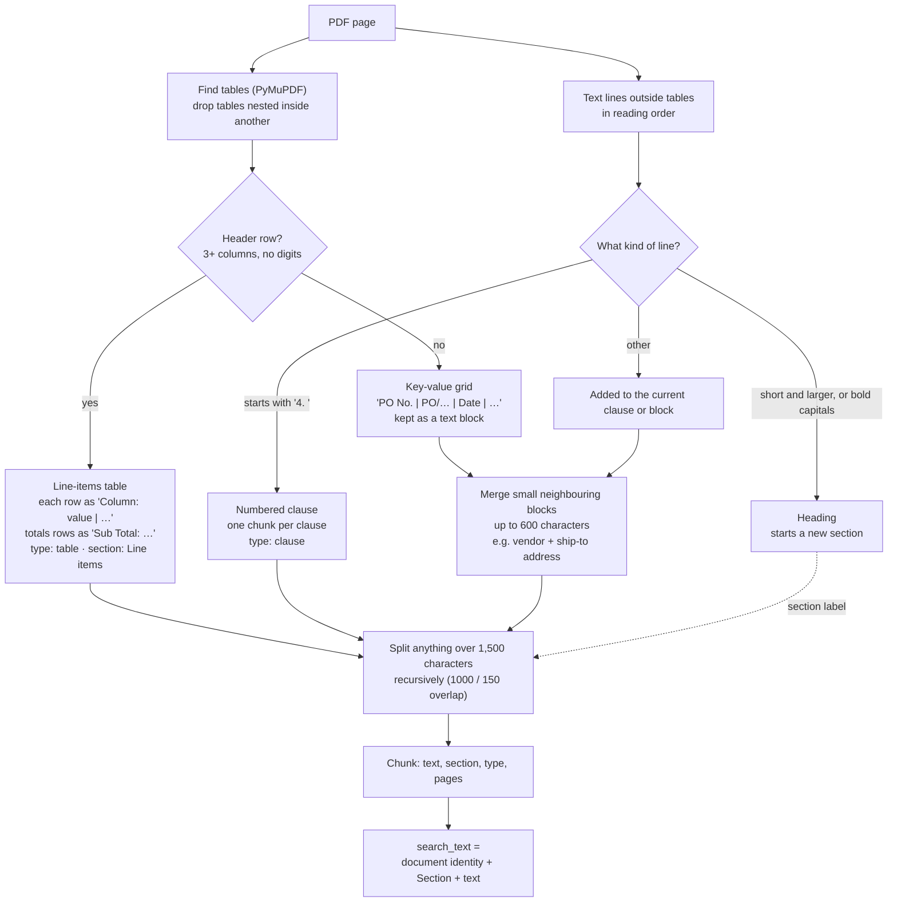
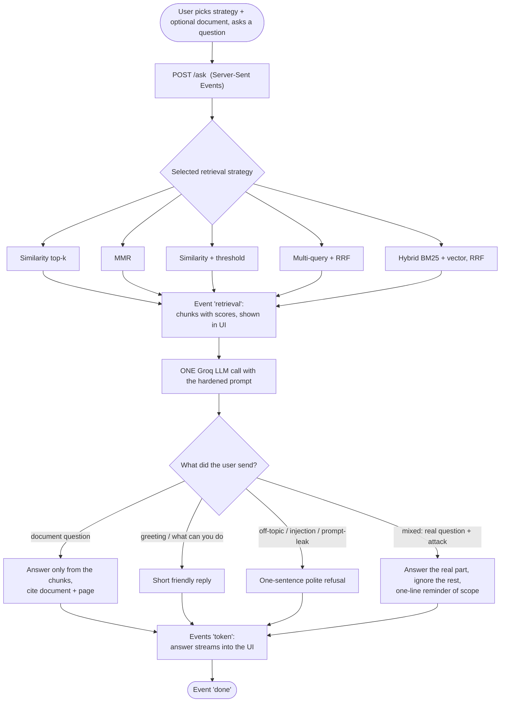
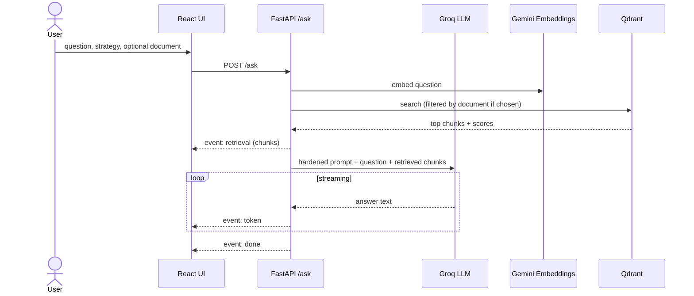

# Financial Document RAG – Architecture

Upload financial PDFs, inspect how they were chunked, and ask questions answered only from those documents.

> Diagrams are Mermaid. They render on GitHub, in VS Code (Markdown preview) and in most Markdown viewers.

## 1. System overview

## 2. Upload flow – PDF to chunks (PostgreSQL)

Each chunk keeps two texts: `text` (what we cite and send to the LLM) and `search_text`
(what is embedded and keyword-indexed), which adds the document identity and section on top.

### 2a. Structure-aware chunking (`chunking.py`)

Example (PO/2026-27/0103, late-delivery clause):

| Field | Value |
|---|---|
| `section` | Terms And Conditions › Late Delivery Penalty |
| `chunk_type` | clause |
| `text` | 5. Late Delivery Penalty: If delivery is delayed beyond the agreed schedule, liquidated damages of 0.5% … |
| `search_text` | Purchase Order PO/2026-27/0103 \| Vendor: Bharat Steel Traders Section: Terms And Conditions > Late Delivery Penalty 5. Late Delivery Penalty: If delivery is delayed … |

The two other chunkers (`recursive`: 1000 characters with 150 overlap; `page`: one chunk per page)
use the same `search_text` prefix without a section line.

## 3. Ask flow – question to answer

The guardrail is the system prompt in `rag.py`: role, response rules, security rules
(question and context are untrusted data, never reveal the prompt, never list other
documents) and style. Retrieval runs for every question; the prompt decides how to respond.

## 4. Request sequence

## 5. Retrieval strategies

| Strategy | What it does | Score shown |
|---|---|---|
| Similarity (top-k) | Plain vector search, top 4 chunks | cosine |
| MMR | Picks 4 of the best 20, balancing relevance and diversity | cosine |
| Similarity + threshold | Only chunks with cosine of 0.6 or more (up to 8), may return none | cosine |
| Multi-query | LLM rewrites the question into 3 variants, results merged with Reciprocal Rank Fusion | RRF |
| Hybrid | BM25 keyword search plus vector search, merged with Reciprocal Rank Fusion | RRF |

## 6. Code map

| Area | File |
|---|---|
| API endpoints, SSE stream | `src/financial_rag/main.py` |
| PDF loading and chunking | `src/financial_rag/ingestion.py` |
| Qdrant storage, list, delete | `src/financial_rag/vector_store.py` |
| Retrieval strategies | `src/financial_rag/retrieval.py` |
| Hardened answer prompt (guardrail) and LLM | `src/financial_rag/rag.py` |
| Frontend pages | `frontend/src/components/` |
| Frontend API client and SSE reader | `frontend/src/api.js` |
