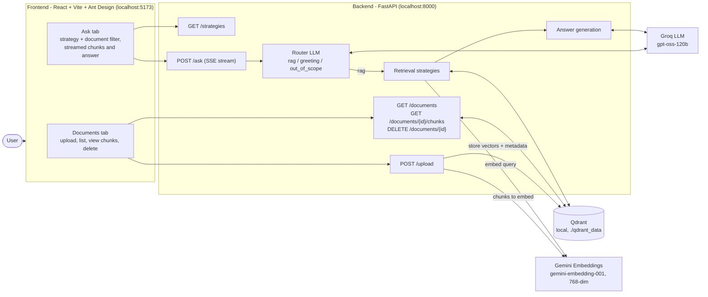
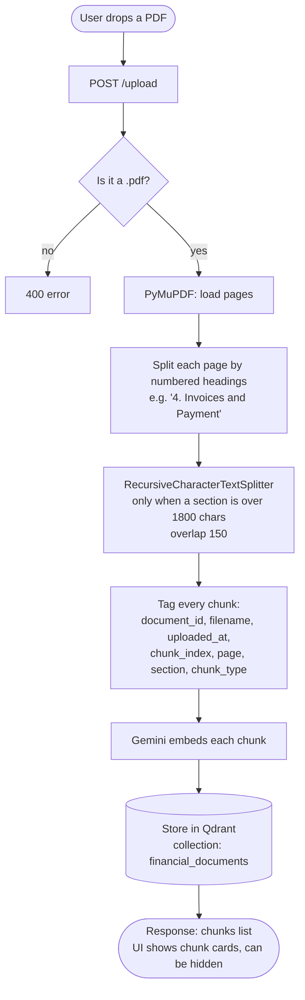
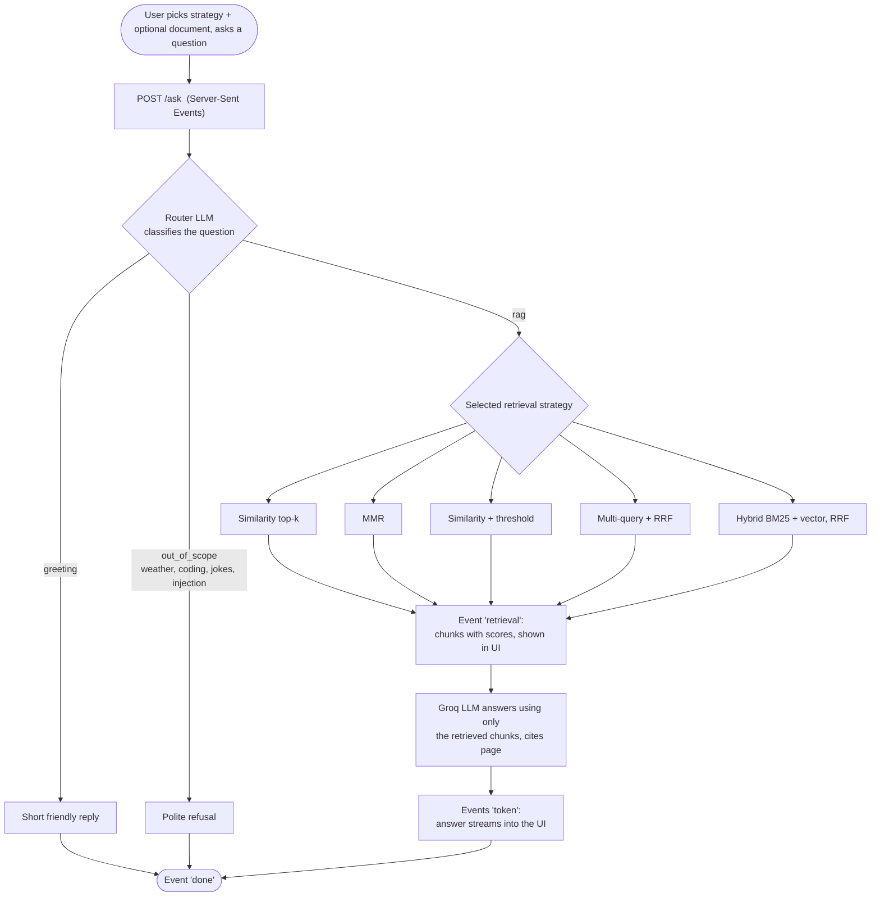
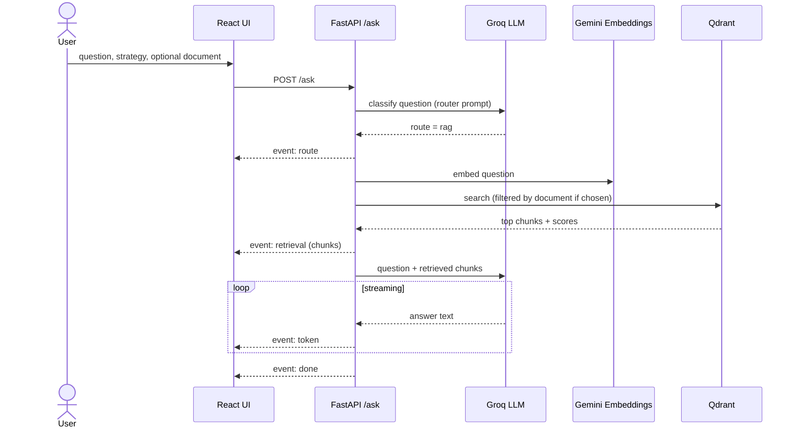

# Financial Document RAG – Architecture

Upload financial PDFs, inspect how they were chunked, and ask questions answered only from those documents.

> Diagrams are Mermaid. They render on GitHub, in VS Code (Markdown preview) and in most Markdown viewers.

## 1. System overview

## 2. Upload flow – PDF to chunks

## 3. Ask flow – question to answer

## 4. Request sequence (rag route)

## 5. Retrieval strategies

| Strategy | What it does | Score shown |
|---|---|---|
| Similarity (top-k) | Plain vector search, top 4 chunks | cosine |
| MMR | Picks 4 of the best 20, balancing relevance and diversity | cosine |
| Similarity + threshold | Only chunks with cosine of 0.6 or more (up to 8), may return none | cosine |
| Multi-query | LLM rewrites the question into 3 variants, results merged with Reciprocal Rank Fusion | RRF |
| Hybrid | BM25 keyword search plus vector search, merged with Reciprocal Rank Fusion | RRF |

## 6. Code map

| Area | File |
|---|---|
| API endpoints, SSE stream | `src/financial_rag/main.py` |
| PDF loading and chunking | `src/financial_rag/ingestion.py` |
| Qdrant storage, list, delete | `src/financial_rag/vector_store.py` |
| Router (guardrail) | `src/financial_rag/router.py` |
| Retrieval strategies | `src/financial_rag/retrieval.py` |
| Answer prompt and LLM | `src/financial_rag/rag.py` |
| Frontend pages | `frontend/src/components/` |
| Frontend API client and SSE reader | `frontend/src/api.js` |
