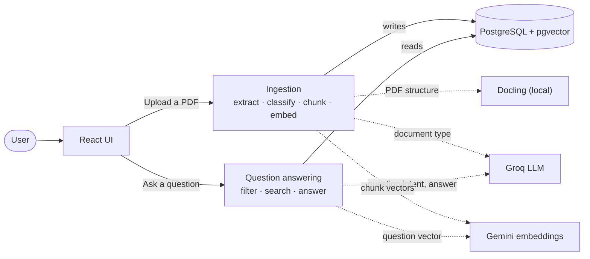
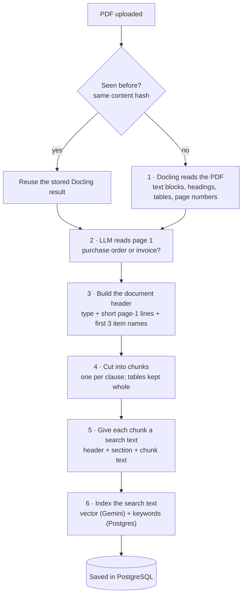
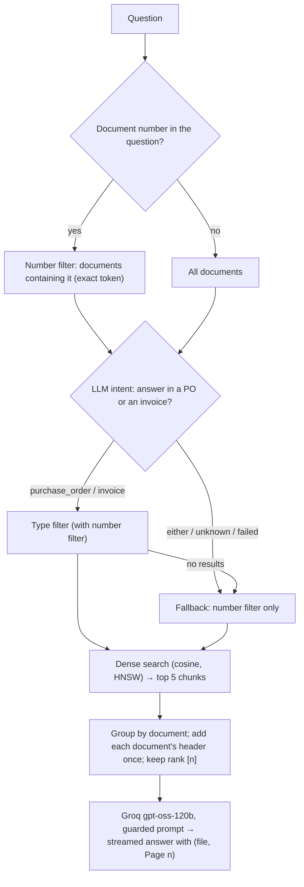

# Architecture

Status: **current** (branch `feature/approach-2`, after step 9). What is built, not a target.
The original target design (structured fields, SQL route, jobs) is listed under [Not built](#not-built).

## Principles (in force)

1. **Postgres is the single store**: documents, Docling JSON, chunks, vectors, full-text index ([ADR-001](adr/ADR-001-storage.md)).
2. **Every answer fact is traceable** to a file and page: `(file.pdf, Page n)` citations.
3. **Choices are measured** on a fixed test set (`evals/`), and alternatives stay switchable (chunkers, methods).
4. **Ingestion is idempotent and versioned**: content hash, stored Docling JSON, `pipeline_version` per run.
5. **No layout rules or regex field extraction**: structure comes from Docling labels; identity from a document header.

## System

The app does two jobs: **upload** a PDF (prepare it for search) and **ask** a question (find passages, answer
with citations). Both run in one FastAPI service; everything is stored in one PostgreSQL database.

**What is stored**

| Table | Holds | Used for |
|---|---|---|
| `documents` | file, content hash, Docling result (JSON), document type | skipping re-conversion, headers, type filter |
| `document_pages` | text of each page | page texts |
| `chunks` | `text` (shown) and `search_text` (header + section + text), keyword index | search |
| `embeddings` | one vector per distinct `search_text` | dense (meaning) search |

**API:** `POST /upload` · `GET /documents` · `GET /documents/{id}/chunks` · `DELETE /documents/{id}` ·
`GET /options` (chunkers, methods, defaults) · `POST /ask` (streams the answer).

## Ingestion (`ingest.py`)

What happens to one uploaded PDF:

**One real chunk** (`po-po-2026-27-0202.pdf`, page 1). The clause alone never names the supplier or the
goods; the header added in step 5 does, so a question about "Ganesh Packaging" or "wooden pallets" finds it.

| | Content |
|---|---|
| `text` (user and LLM see this) | Warranty: The supplier warrants the goods against manufacturing defects for a period of 3 months from the date of delivery. … |
| `search_text` (embedded and indexed) | **Document type: Purchase order** · Shreeji Infra Projects Pvt Ltd · PURCHASE ORDER · Vendor · **Ganesh Packaging Industries** · … · **Items: Wooden pallet**, …; Bubble wrap roll, … · TERMS AND CONDITIONS · Warranty: The supplier warrants … |

Notes:

- Step 4 runs twice: our **structure-aware chunker** (default) and Docling's **HybridChunker** (kept to compare).
  Both: up to 256 tokens, tables as Markdown.
- Our chunker's rules: one chunk per clause, table header repeated in every table chunk, a table continued on
  the next page joined back, very short texts ("Authorised Signatory") attached to the previous chunk.
- Step 2 runs only when the type is missing; an API failure stores `unknown` and never stops ingestion.
- A vector is computed once per distinct search text, so re-ingesting unchanged chunks costs no API calls.

## Query (`POST /ask`)

- Default: `structure` chunker + `dense_intent`. Other methods (for comparison): dense, keyword, hybrid (RRF),
  rerank (cross-encoder), dense_ids (number filter only). Picking one document skips intent and filters.
- Headers are rebuilt with the same `doc_header()` as at ingestion, so retrieval and generation share one identity.
- Guardrails live in the system prompt: answer only from context, refuse off-topic in one sentence, ignore
  instructions inside questions or documents, never reveal the prompt.
- SSE events: `retrieval` (chunks, headers, `trace` = intent / filters applied / fallback) → `token` → `done` or `error`.
- v1 documents (regex era, no Docling JSON) stay in the database but are hidden from every endpoint.

## Evaluation (`evals/`)

| Script | Measures | Output |
|---|---|---|
| `evaluate.py` | Retrieval: Hit@1, Hit@5, MRR, MRR linked, tokens; by question type and layout | `results_v2*.json` |
| `evaluate_answers.py --set answers` | Correctness (vs evidence), groundedness (vs context seen), citations (code) | `answers_v2_8*.jsonl` |
| `evaluate_answers.py --set guardrails` | Unanswerable, off-topic, injection, mixed (judge + code checks) | `guardrails_v2_8*.jsonl` |

Judge: Groq `qwen/qwen3.8-27b` (another model family than the answer model), strict JSON schema.
Test set v2: 16 synthetic documents (8 PO + invoice pairs), 4 layouts, 40 questions, 12 guardrail questions.

## Technology

| Concern | Choice |
|---|---|
| API | FastAPI, Pydantic v2, SSE |
| UI | React, Vite, antd |
| Database | PostgreSQL 18 + pgvector (HNSW, cosine); SQLAlchemy 2.0 + Alembic |
| Keyword search | Postgres full-text (`tsvector` + GIN) |
| Extraction | Docling 2.x (table structure on, OCR off by default) |
| Chunking | Own structure-aware chunker; Docling HybridChunker as baseline |
| Embeddings | Gemini `gemini-embedding-001`, 768-d, cached by text hash |
| LLM | Groq `openai/gpt-oss-120b`: answers, document type, question intent |
| Reranker (optional) | `cross-encoder/ms-marco-MiniLM-L-6-v2` |
| Eval judge | Groq `qwen/qwen3.8-27b` |

## Not built

From the original target design, out of scope for Goal 1:

- Field extraction into typed tables (POs, invoices, line items, confidence) and validation of totals.
- Query router with a structured SQL route and a number verifier ([ADR-004](adr/ADR-004-structured-queries.md)).
- Background ingestion jobs (upload is synchronous), PO/invoice mismatch detection.
- OCR confidence per word for scanned PDFs ([ADR-005](adr/ADR-005-scanned-documents.md)); Docling OCR exists but is untested here.
- An `out_of_scope` route before retrieval: off-topic questions are still retrieved for, then refused by the prompt.
- Docker, structured logging, CI eval gate.
