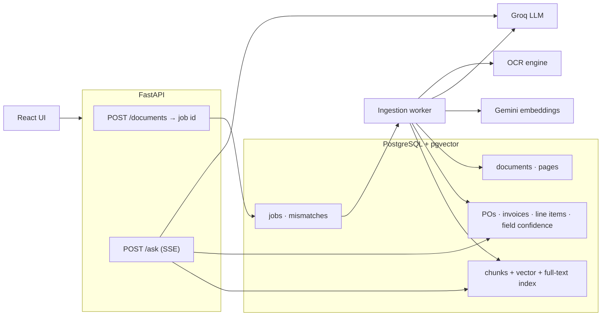
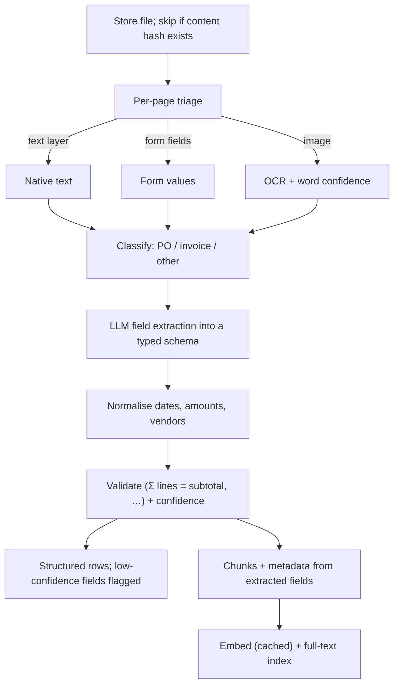
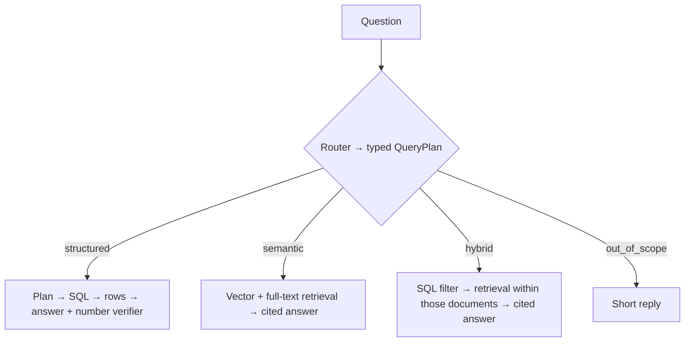

# Target Architecture

Status: **Proposed.** Table details are decided in the schema step.

## Principles

1. **Postgres is the single source of truth**: documents, fields, chunks, vectors and search indexes ([ADR-001](adr/ADR-001-storage.md)).
2. **Numbers come from SQL**, never from the model; a verifier rejects unsupported numbers.
3. **Every fact is traceable** to document and page; every field keeps its source and confidence.
4. **Doubtful data is flagged**, not guessed.
5. **Choices are measured** on the golden set and switchable for ablation.
6. **Ingestion is idempotent and versioned** (content hash, `pipeline_version`).
7. **Models, thresholds and budgets live in config.**

## System

## Ingestion

The LLM copies values; code checks them. Chunks inherit document identity and fields, which enables filter-first hybrid retrieval.

## Query

QueryPlan is validated data, not SQL ([ADR-004](adr/ADR-004-structured-queries.md)). The SSE contract (`retrieval` → `token` → `done`, with `elapsed_ms`) is kept.

## Technology

| Concern | Choice | Status |
|---|---|---|
| API | FastAPI, Pydantic v2 | In use |
| Database | PostgreSQL 18 + pgvector 0.8.7 (HNSW) | Accepted |
| Keyword search | Postgres full-text (`tsvector` + GIN); BM25 via `pg_search` if needed | Proposed |
| Data access | SQLAlchemy 2.0 + Alembic | Proposed |
| LLM | Groq `openai/gpt-oss-120b` | In use |
| Embeddings | Gemini `gemini-embedding-001`, 768-d, cached by text hash | In use |
| PDF | PyMuPDF | In use |
| OCR | Local engine with word confidence ([ADR-005](adr/ADR-005-scanned-documents.md)) | Proposed |
| Jobs | Job table + worker process | Proposed |
| Logging | `structlog` JSON | Proposed |
| Packaging | Docker Compose | Proposed |

## Changes from the current app

| Today | Target |
|---|---|
| Qdrant (local) | pgvector |
| In-memory BM25 per query | Postgres full-text index |
| `/upload` blocks until embedded | Background job |
| Metadata: page, section, filename | + document identity and extracted fields |
| Guardrail in the answer prompt | Router with `out_of_scope` + prompt guard |
| No SQL answers | Structured route with verifier |
